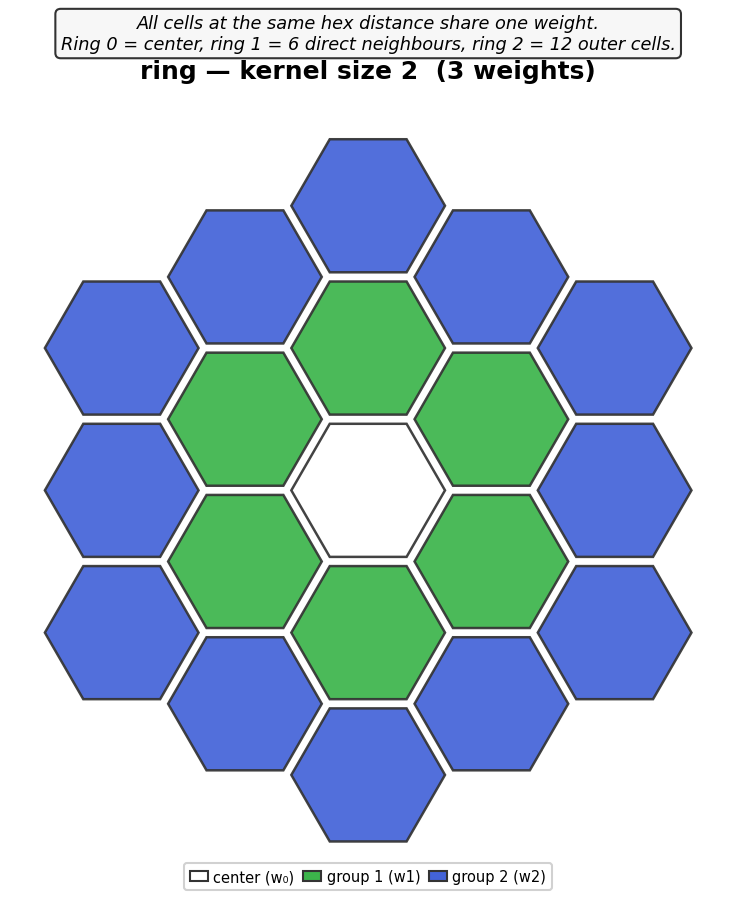
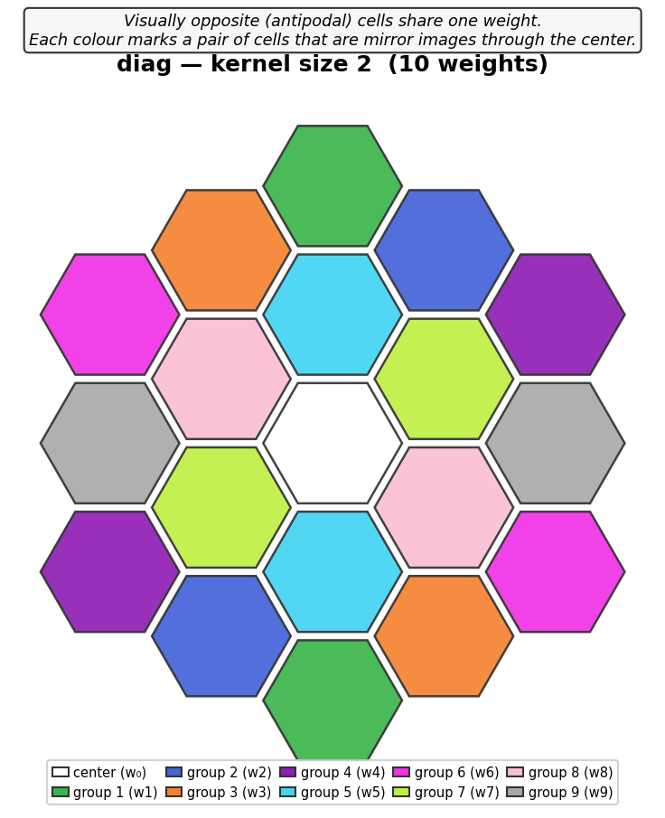
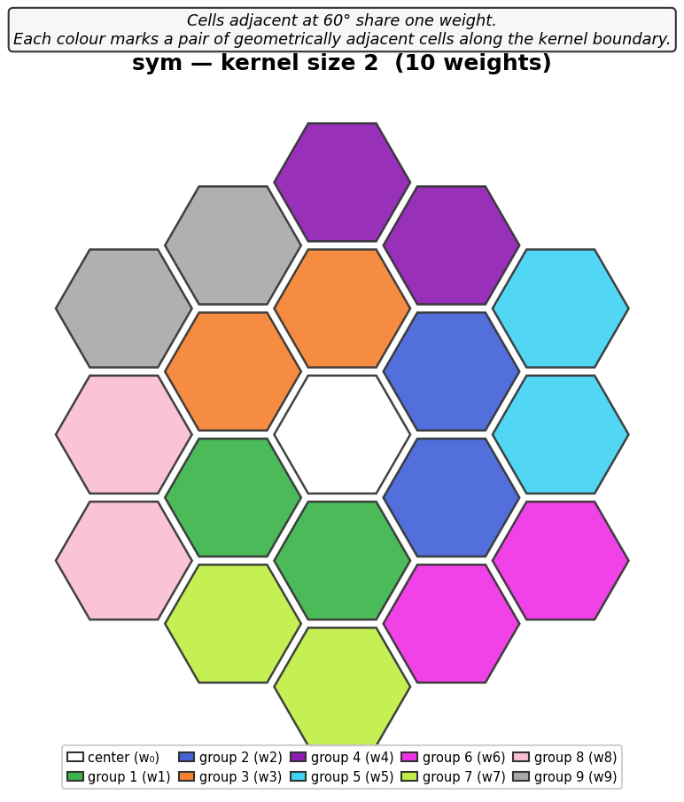

# keras-hexagdly

Keras 3 port of [HexagDLy](https://github.com/ai4iacts/hexagdly): convolution
and pooling methods for hexagonally sampled data, originally written for
PyTorch by Tim Lukas Holch and Constantin Steppa (ai4iacts).

This port reproduces HexagDLy's hexagonal addressing scheme and sub-kernel
decomposition exactly (bit-for-bit equivalent outputs, cross-checked against the
upstream PyTorch package in
[hexagdly-oracle](https://github.com/YugnatD/hexagdly-oracle)), but
is built on [Keras 3](https://keras.io) so it runs on any backend
(TensorFlow, JAX, PyTorch) and uses a channels-last (`NHWC`/`NDHWC`) tensor
layout instead of PyTorch's channels-first.

It also adds three functionalities that do not exist in upstream HexagDLy:

- **`share_neighbors`** (`Conv2d`, `Conv3d`): ties the weights of several cells
  of a hexagonal kernel together instead of giving every cell its own
  independent weight, which cuts the parameter count and imposes a geometric
  symmetry on the learned kernel. Three modes -- `"ring"`, `"diag"`, `"sym"` --
  are [illustrated below](#new-share_neighbors----weight-sharing-across-kernel-cells).
- **`depth_padding="same"`** (`Conv3d` only): zero-pads the depth/time axis
  so the temporal kernel is centred on each time step and the output depth
  equals the input depth, instead of HexagDLy's `"valid"`-only behaviour
  (output depth shrinks by `kernel - 1`).
- **[hls4ml export](#fpga-export-via-hls4ml)** for FPGA synthesis, currently
  limited to `io_stream` and the 2D layers.

Weights trained with [pytorch-hexagdly](https://github.com/YugnatD/pytorch-hexagdly)
can be loaded into these layers -- see
[`keras_hexagdly.torch_interop`](src/keras_hexagdly/torch_interop.py) and
[`notebooks/pytorch_to_keras_example.ipynb`](notebooks/pytorch_to_keras_example.ipynb).
No torch dependency is required: a plain `.npz` of the state dict works.

See [NOTICE.md](NOTICE.md) for attribution details and citation information.

## Installation

```
pip install keras-hexagdly
```

For development (running the test suite, which also checks parity against
upstream PyTorch HexagDLy, and the example notebooks):

```
pip install keras-hexagdly[dev]
```

## Usage

```python
import keras
import keras_hexagdly as hgly

hexconv = hgly.Conv2d(filters=3, kernel_size=1, strides=4)
x = keras.random.uniform((1, 21, 21, 1))  # channels-last: (N, H, W, C)
y = hexconv(x)
```

`filters`/`kernel_size`/`strides`/`use_bias` follow standard Keras layer
conventions exactly (`filters`/`kernel_size` are positional-capable, just
like `keras.layers.Conv2D(filters, kernel_size, strides=...)`). `in_channels`
is never a constructor argument -- it's always inferred from the input on
first call, like every standard Keras layer.

**Breaking change in 0.4.0**: the original PyTorch-hexagdly-style
constructor names (`in_channels`, `out_channels`, `stride`, `bias`) have
been removed entirely -- passing them now raises, rather than being
silently accepted. This was a deliberate, one-time breaking change (see
[CHANGELOG.md](CHANGELOG.md)) made specifically because those old names,
combined with Python's positional argument binding, meant
`Conv2d(32, 3, strides=2)` -- written the way anyone familiar with
`keras.layers.Conv2D` naturally would -- silently built the wrong layer
(`in_channels=32, out_channels=3, kernel_size=1`) instead of raising. If you
have code or saved models depending on the old names, pin
`keras-hexagdly==0.3.1`, the one transitional release where both forms
worked side by side.

### New: `share_neighbors` -- weight sharing across kernel cells

Available on `Conv2d` and `Conv3d`. `share_neighbors` reduces the number of
learnable parameters by grouping kernel cells that share a single weight.
Three modes are available, illustrated below for `kernel_size=2` (19 cells):

| `share_neighbors="ring"` | `share_neighbors="diag"` | `share_neighbors="sym"` |
|:---:|:---:|:---:|
|  |  |  |
| **3 weights** -- cells at the same hex distance from center share one weight (concentric rings). | **10 weights** -- visually opposite (antipodal) cells share one weight. | **10 weights** -- geometrically adjacent 60 degree pairs share one weight. |

- **`"ring"`**: the most aggressive reduction. All 6 direct neighbours share one
  weight, all 12 outer cells share another. Enforces exact 6-fold rotational
  symmetry of the learned kernel.
- **`"diag"`**: antipodal symmetry -- each cell and its mirror image through the
  center share a weight. Useful when the kernel should be point-symmetric.
- **`"sym"`**: 60 degree adjacent pairs -- consecutive neighbours along the kernel
  boundary share a weight. Useful when the kernel should reflect local
  rotational symmetry.

For `kernel_size=1` (7 cells): ring=2 weights, diag=4, sym=4.
For `kernel_size=2` (19 cells): ring=3 weights, diag=10, sym=10.
Compare to the default `share_neighbors=None`, which gives 7 and 19 independent
weights. `"ring"` works at any kernel size; `"diag"` and `"sym"` are defined for
`kernel_size` 1 and 2 only, matching
[pytorch-hexagdly](https://github.com/YugnatD/pytorch-hexagdly), which does not
define them beyond n=2 either.

```python
hexconv = hgly.Conv2d(filters=3, kernel_size=2, share_neighbors="ring")
```

`share_neighbors=True` is accepted as an alias for `"ring"`.

### New: same-padded temporal convolution (Conv3d)

```python
conv3d = hgly.Conv3d(in_channels, out_channels, kernel_size=(depth_k, hex_k),
                      depth_padding="same")  # output depth == input depth
```

Before applying these layers, your data must already be arranged on the
square-tensor layout HexagDLy expects (zig-zag columns); see
[notebooks/keras_hexagdly_addressing_scheme.ipynb](notebooks/keras_hexagdly_addressing_scheme.ipynb)
for how to get there from raw detector coordinates, and
[notebooks/keras_hexagdly_2d_example.ipynb](notebooks/keras_hexagdly_2d_example.ipynb)
for a worked convolution/pooling example, including the new features above.

## Notebooks

Ported from [HexagDLy's own notebooks](https://github.com/ai4iacts/hexagdly/tree/master/notebooks), one-to-one where the content is framework-specific, lightly adapted where it depends on a torch-specific dataloader/training loop:

- [`keras_hexagdly_2d_example.ipynb`](notebooks/keras_hexagdly_2d_example.ipynb) -- basic `Conv2d`/`MaxPool2d` usage, hex-vs-square symmetry, and the new `share_neighbors`/`depth_padding` features.
- [`keras_hexagdly_addressing_scheme.ipynb`](notebooks/keras_hexagdly_addressing_scheme.ipynb) -- how to map raw hexagonal detector coordinates onto the square-tensor layout the layers expect (backend-independent; near-identical to upstream).
- [`keras_hexagdly_custom_kernels_example.ipynb`](notebooks/keras_hexagdly_custom_kernels_example.ipynb) -- building a custom Gaussian smoothing kernel with `Conv2d_CustomKernel`.
- [`keras_hexagdly_cnn_example.ipynb`](notebooks/keras_hexagdly_cnn_example.ipynb) -- a small CNN classifying toy hexagonal shapes, trained with `model.fit`.
- [`keras_hexagdly_hex_vs_square.ipynb`](notebooks/keras_hexagdly_hex_vs_square.ipynb) -- parameter-count and timing benchmark of hex vs. square kernels, plus a hex-CNN-vs-square-CNN classification comparison.

## FPGA export via hls4ml

The hex layers can be synthesised to HLS C++ through
[hls4ml](https://github.com/fastmachinelearning/hls4ml). The layers are replaced
by a fused line-buffer kernel that keeps only the resident rows of the frame in
a shift register, rather than materialising the whole gathered tensor.

```python
import hls4ml
from keras_hexagdly.hls4ml_handler import register_hex_gather_layers
from keras_hexagdly.hls4ml_ext import patch_model_for_hls, hex_reuse_config, check_hls_config

register_hex_gather_layers("Vitis")
hls_ready = patch_model_for_hls(model)                 # strategy="linebuffer"

config = hls4ml.utils.config_from_keras_model(hls_ready, granularity="name")
hex_reuse_config(config, hls_ready)                    # per-layer ReuseFactor
check_hls_config(config, hls_ready, io_type="io_stream")

hls_model = hls4ml.converters.convert_from_keras_model(
    hls_ready, hls_config=config, io_type="io_stream", backend="Vitis",
)
```

### Supported scope

**Only `io_stream` and the 2D layers (`Conv2d`, `MaxPool2d`) are supported for
now.** That is the combination that is covered by C-simulation and validated by
RTL co-simulation.

| | `io_stream` | `io_parallel` |
|---|---|---|
| `Conv2d`, `MaxPool2d` | **supported** | not supported |
| `Conv3d`, `MaxPool3d` | not supported | not supported |

The unsupported paths are not silently wrong -- they raise. `patch_model_for_hls`
raises `NotImplementedError` on a 3D layer, and `check_hls_config` raises on
`io_type="io_parallel"`. Both accept `allow_unvalidated=True` if you want to
experiment with them anyway, but nothing about their numerics or resource usage
is guaranteed.

`hex_reuse_config` matters more than it looks: hls4ml's
`config_from_keras_model(granularity="name")` writes `ReuseFactor=1` into every
layer entry it recognises, which overrides the model-level value -- but custom
layers get no entry and inherit the model-level one instead. Without an explicit
per-layer setting, a single model ends up mixing two different reuse factors.

## Testing

```
pip install -e .[dev] --no-build-isolation   # see note below
pytest tests/
```

(`--no-build-isolation`: only needed if your `pip` is old -- pip 22.0.2's
isolated build environment was observed to pick up a `setuptools` version
that mis-names the built wheel `UNKNOWN`. Verified clean with a modern pip
(>=23) in a fresh venv: plain `pip install .` works with no workaround.
Either way, `pytest tests/` works without installing anything -- `conftest.py`
puts `src/` and `tests/` on `sys.path`.)

Most of the suite no longer lives here. It has moved to
**[hexagdly-oracle](https://github.com/YugnatD/hexagdly-oracle)**, the shared
test repo for this library and
[pytorch-hexagdly](https://github.com/YugnatD/pytorch-hexagdly): hand-verified
layer outputs, `share_neighbors` weight-sharing oracles, `depth_padding`,
mixed precision, serialization, edge cases, indexed-equivalence and the hls4ml
export tests (including C-simulation). `tests/` here keeps only what is
genuinely local.

To run the full suite, check the oracle out as a sibling directory:

```
git clone https://github.com/YugnatD/hexagdly-oracle
PYTHONPATH=hexagdly-oracle/src pytest tests/ hexagdly-oracle/tests/
```

Verified to pass on all three Keras 3 backends (set `KERAS_BACKEND=tensorflow|torch|jax`
before importing keras; tensorflow is the default if unset):

```
KERAS_BACKEND=tensorflow   # 891 passed,  7 skipped
KERAS_BACKEND=torch        # 881 passed, 17 skipped
KERAS_BACKEND=jax          # 806 passed, 92 skipped (slower: per-shape JIT compile)
```

A GitHub Actions workflow ([.github/workflows/test.yml](.github/workflows/test.yml))
runs this matrix (3 backends x 3 Python versions) plus `ruff check`/`ruff format --check`
on every push and PR, checking out the oracle repo as part of the job.

Note for GPU users on the torch backend: the Keras torch backend runs on CUDA
when a GPU is visible, and PyTorch defaults to `cudnn.allow_tf32 = True`, so
convolutions are computed in TF32 (~1e-3 relative precision). That is enough to
break equivalence assertions on hex kernels, which are wide by construction
because dilation is done by zero insertion. The oracle's `conftest.py` pins the
flag off for the test session; the library itself never touches global torch
settings.

## Disclaimer

Like upstream HexagDLy, this is a prototyping tool: it favors flexibility
over performance. Once a model's architecture (kernel size, stride, input
shape) is fixed, hard-coding those parameters would yield a faster
implementation.

## Performance

See [benchmarks/](benchmarks/) for a speed comparison against upstream
PyTorch HexagDLy. Short version: run eagerly on CPU, this port is 1-7x
slower than upstream for the same reason upstream itself is slow (the hex
sub-kernel decomposition costs several op-dispatches per call -- a design
choice, not a regression). Wrapped in a compiled call (`jax.jit`/
`tf.function`, which `model.fit`/`model.predict` do automatically) it is
typically *faster* than upstream's eager PyTorch, sometimes by an order of
magnitude. `torch.compile` support is currently unreliable for this layer
(see the benchmarks README for why); eager execution on a GPU is the
recommended way to get speed on the torch backend.

## Changelog

See [CHANGELOG.md](CHANGELOG.md).

## License

MIT, see [LICENSE](LICENSE). This is a derivative work of HexagDLy
(Copyright (c) 2018 ai4iacts); see [NOTICE.md](NOTICE.md).
